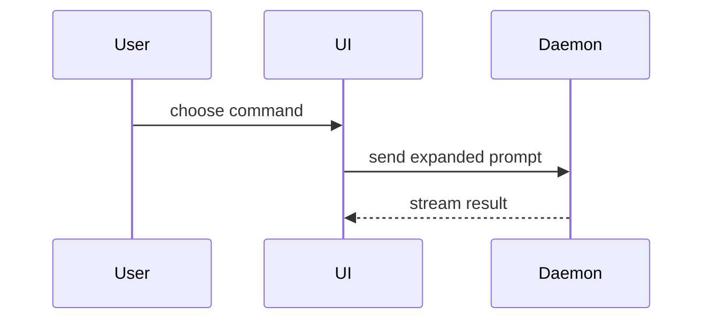

Use this template for writing the PR body:

```markdown
## Summary

<diagram, diff-sketch, or tree>

## Evidence

- **Before:** <screenshot/output/failing test run>
  **After:** <screenshot/output/passing test run>

## Merge Danger

**Door:** <one-way or two-way>

<optional: description>

**Blast Radius:** <one-word description>

<optional: potential ramifications of merge>

## Checked

- Plan (`/grill-with-docs`), design (`/grill-design`), spec and tickets:
- Tests written first:
- `/code-review` (since which commit):
- `/codebase-design`:
- `pnpm --silent qa check` (or `discord-sandbox` for the bot):
- `main` merged, `pnpm smoke`, the preview and a Refresh's revalidate:
```

## Sections

Skip all preambles and keep prose brief. Use the user's domain language from `GLOSSARY.md`.

### Summary

Pick the smallest view that makes the key point clear.

- Show logic or an algorithm as pseudocode:

```text
on(save)
  if content is unchanged
    return cached result
  write new content
  return fresh result
```

- Show runtime control flow as a call tree:

```text
submitForm
  createSession
    persistPrompt
    launchAgent
  navigateToSession
```

- Show UI structure as a component tree, including state and module boundaries that matter:

```text
<SessionPage> (apps/example/src/routes/session.tsx)
  useSessionEvents()
  <SessionToolbar>
    <RunSkillButton> (packages/ui)
```

- Show file responsibility or a broad refactor as a shallow file tree:

```text
src/
├── commands/       # parses user actions
├── sessions/       # owns session state
└── transport/      # sends API requests
```

- Show component interaction, control flow, or data flow with Mermaid:



- Use `diff` when the point is what changes and the surrounding shape already exists. Match the diff shape to the topic.

For a component change:

```diff
 <SessionPage>
   useSessionEvents()
   <SessionToolbar>
+    <RunSkillButton />
   <SessionTimeline>
+    <SkillResultCard />
```

For a file-layout change:

```diff
 src/
 ├── commands/
+│   └── show-me.ts       # expands the slash command
 ├── sessions/
-└── transport.ts
+└── transport/
+    ├── client.ts
+    └── stream.ts
```

For a call-tree or call-stack change:

```diff
 submitForm
   createSession
     persistPrompt
+    expandSkillMention
     launchAgent
-  navigateToSession
+  navigateToSession
+    subscribeToEvents
```

For a state or control-flow change:

```diff
 on(save)
-  write content
+  if content is unchanged
+    return cached result
+  write new content
+  invalidate cache
```

- Show the whole block when most of it is new, when omitted context would hide ownership or order, or when the user needs a copyable target shape:

```ts
function expandSkill(command: string): string {
  const skillName = command.slice(1);
  return `use the ${skillName} skill`;
}
```

#### Guidance

Place each visual next to the short text it supports. Keep only the calls, files, props, states, and boundaries needed to answer the user's current question or the options to resolve the current discussion point.

You may use one of these, you may use several, it is unlikely you will use all of them. Use your judgement and don't overwhelm the user.

### Evidence

Concrete evidence that the change works. Show a before and after.

Screenshots are S-tier - when the environment is set up for it and the change is visual.

Execution-based evidence is A-tier. Test results, console output. Show the exact test that now fails and passes, using pseudocode.

### Merge Danger

Describe whether it's a one-way or two-way door. You can walk back through two-way doors, but not one-way doors. A PR that is cheap to roll back is lower risk. Changes that involve destructive actions or hard-to-reverse decisions are one-way doors.

The blast radius is the potential impact or scope of the changes introduced by this PR. Consider all possibilities. Examples are layout shift, breakages for consumers, mobile responsiveness, etc.

## In this repo

`.github/pull_request_template.md` is this template. A body sent through `gh` or the API skips
the template, so write all four sections yourself.

- Put `Closes #<spec>, closes #<ticket>.` on the line above Summary. A project thread's two
  attribution lines come first, above it; a closing footer stays last.
- **Summary** replaces the old Before / After / How prose: the visual carries the How, and the
  design verdict and prototype branch from `/grill-design` go in one line under it.
- **Evidence** for a page change: `pnpm --silent qa check` draws each changed view beside
  production (`docs/site.md`, "Checking a change"). A picture shows in the PR only from a URL,
  so from a cloud session link the changed page on the PR's preview and quote qa's `summary:`
  line; attach the screenshot itself when the session can upload one. For a bot change, the
  sandbox post `discord-sandbox` made, read back with `discord show`. For the collector, the test
  that went red then green, or what a `--dev` run wrote.
- **Merge Danger** one-way doors here: a migration applied to production, anything that rewrites
  or deletes `entries` (the database is the only copy of the scores), a message the bot posts in
  a real server, a Steam or Workshop write. Most site, bot and tooling changes are two-way: a
  revert redeploys. Name the blast radius as a word or short phrase in this repo's own surfaces: the site's pages, the
  Refresh, the Daily watcher, Multiballs in one server or both, an agent's workflow.
- **Checked** keeps its six lines, one per step of `docs/agents/feature-workflow.md`, each saying
  what ran and what it found, or "skipped" and why. It stays: the vendored `code-review` reads it so it doesn't re-report what was
  verified, and it lists any gap left unchecked.
